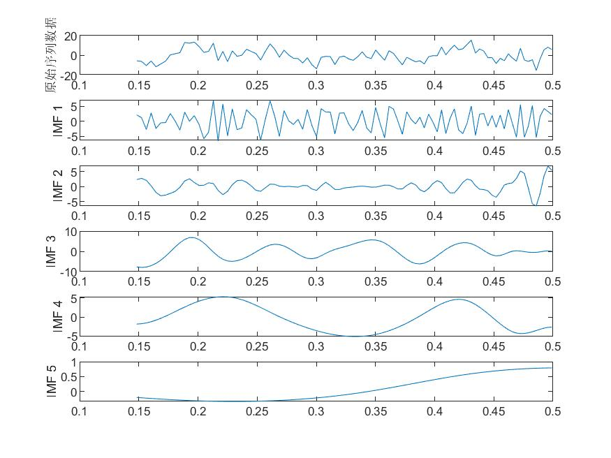
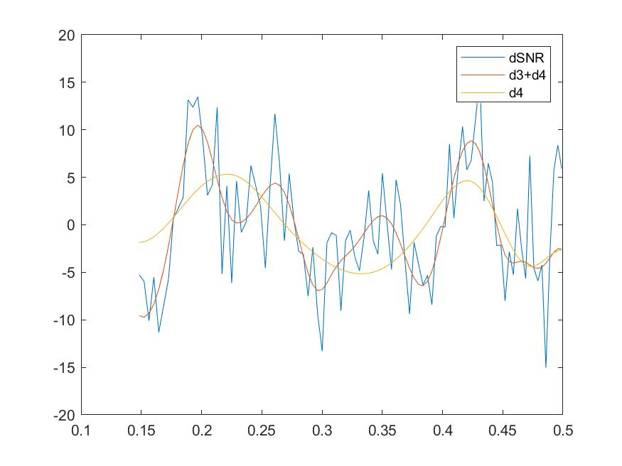

# MATLAB Signal Decomposition 5th Edition - ICEEMDAN Decomposition

ICEEMDAN (Improved Complete Ensemble EMD with Adaptive Noise) is a signal decomposition method based on the Empirical Mode Decomposition (EMD). Unlike traditional EMD methods, ICEEMDAN introduces an adaptive noise and complete ensemble strategy to enhance the stability and accuracy of the decomposition. In the ICEEMDAN method, firstly, EMD is used to decompose the original signal into multiple Intrinsic Mode Functions (IMF), then the adaptive noise algorithm is applied to remove noise from each IMF, and finally, the denoised IMFs are integrated completely to obtain the decomposed signal. Compared to traditional EMD methods, the use of the adaptive noise algorithm in ICEEMDAN can reduce the mode mixing problem during the decomposition process. Additionally, the complete ensemble strategy ensures that the decomposed signal retains all information of the original signal, improving the accuracy of the decomposition. The ICEEMDAN decomposition method has been widely applied in fields such as signal processing, image processing, and speech processing, demonstrating high decomposition effects and reliability.

Signal Decomposition Diagram:

Signal Reconstruction Diagram:

Video Tutorial:
\n        \n          \n          \n          \n          \n            To view this video please enable JavaScript, and consider upgrading to a\n            web browser that\n            supports HTML5 video\n  

## Images

<!-- PAYMENT_BLOCK -->

## Get this dataset

- Payment link (Stripe): [Buy now](https://buy.stripe.com/3cs8yP7sY87d0vu9AB)
- Payment QR code: 

<!-- /PAYMENT_BLOCK -->
